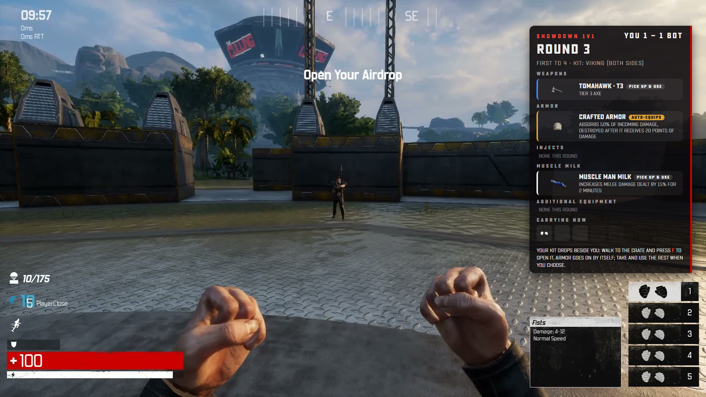

# Showdown pre-round HUD and round flow

Files: `patch/src/Victory/Content/uiresources/hud/js/ShowdownHud.js` (in match), `.../FrontEnd/js/Showdown.js` (menu), `server/showdown.js` + `server/server.js` (series), `patch/make_showdown.py` (kit), `patch/make_server_config.py` (loads the HUD script).

The screenshot is the real panel code with test data (round 3, 1-1, Viking kit), drawn by Edge over a frame from a Showdown clip. It is not an in-game capture.

## Round flow

1. SHOWDOWN tile → the menu queues `showdown` → the server starts round *n* of the player's series (`remaster-showdown` `round`) and answers `match-ready` `showdown:1v1`.
2. The menu starts the arena match (`StartTraining("Practice")`).
3. The HUD loads with the match and asks `GET /api/showdown`. The server finds the match from its open ticket and returns the round, score and kit. The panel shows for 14 s, top right.
4. The round is played: one bot, the same kit for both sides, delivered at round time 0.
5. The HUD reports the result (`/api/matchresult`). The server scores the round (15 s minimum, kills capped at 1) and replies with the series. The HUD shows "ROUND n WON/LOST" or "SHOWDOWN VICTORY/DEFEAT" over the stock end screen.
6. Back in the menu, the server sends `next` (score, then the next round after an 8 s countdown; START NOW / LEAVE SHOWDOWN) or `over` (final score once; CLOSE / PLAY AGAIN).

Series: first to 4 round wins, at most 7 rounds. A round left without a result (quit, crash) is lost when the next starts. Leaving ends the series as a forfeit. A series idle for 30 minutes is dropped.

## Panel contents

| Part | Source |
|---|---|
| Round, score, "first to 4" | server series |
| Kit name, "both sides" | `server/data/showdown.json` (from `make_showdown.py` KIT) |
| WEAPONS, ARMOR, INJECTS, MUSCLE MILK, ADDITIONAL EQUIPMENT | the kit's items by category; "None this round" when a section is empty |
| Item art | the game's `uiresources/images/weapons/<ItemClass>.png` |
| Rarity stripe | weapon tier (T1 grey, T2 green, T3 blue, T4 purple); untiered items by kind |
| AUTO-EQUIPS / PICK UP & USE | armor only is auto (the game's `bUseIfSpawnedWith`) |
| CARRYING NOW | the HUD's own inventory slots (`WeaponSlots`), redrawn whenever the game changes a slot |
| How to get the kit | "walk to the crate and press F" (Use = F in DefaultInput.ini) |

The panel shows only what the server sends and what the game's slots hold; nothing is generated in the HUD.

## Not verified yet

- In game: the panel, the banner and the menu screens have not run inside the game's Coherent UI. They need the server update (the `/api/showdown` endpoint) and a full patch build.
- Layout was checked at 1600x900 and 1920x1080 in Edge. Sizes are in viewport units, so other 16:9 resolutions scale; ultrawide is not checked.
